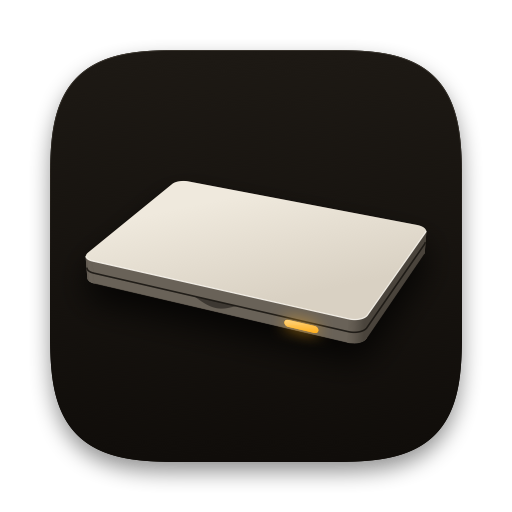
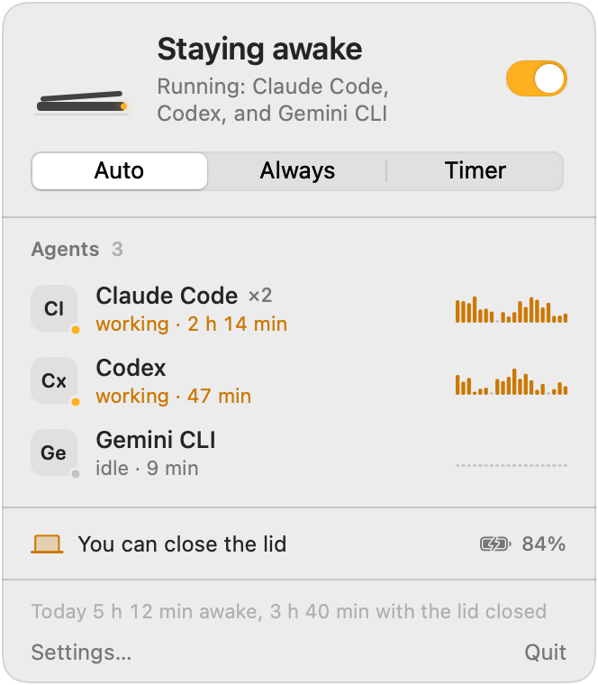
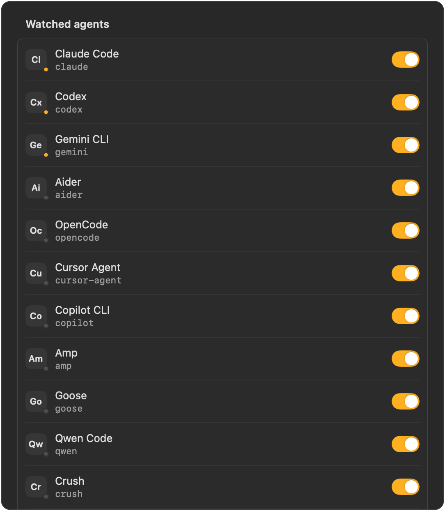

<p align="center">
  
</p>

<h1 align="center">Vibecode24</h1>

<p align="center">
  <b>Close the lid. Your agents keep working.</b><br>
  A macOS menu bar switch that keeps your MacBook awake with the lid closed while Claude Code, Codex and other AI agents run in your terminal.
</p>

<p align="center">
  <a href="https://github.com/vladislavkovalskyi/vibecode24/releases/latest"></a>
  <a href="https://github.com/vladislavkovalskyi/vibecode24/releases"></a>
  <a href="LICENSE"></a>
  
  
</p>

<p align="center">
  <b>English</b> · <a href="README.ru.md">Русский</a> · <a href="README.uk.md">Українська</a>
</p>

<p align="center">
  <picture>
    <source media="(prefers-color-scheme: dark)" srcset="docs/assets/popover-dark.png">
    <source media="(prefers-color-scheme: light)" srcset="docs/assets/popover-light.png">
    
  </picture>
</p>

## Why

You start Claude Code on a long refactor, close the MacBook and walk to a meeting. macOS goes to sleep, the terminal freezes, and the agent stops halfway through. `caffeinate` and the usual keep-awake apps work while the lid is open, but a closed lid without an external display still puts the Mac to sleep.

Vibecode24 keeps the Mac awake with the lid closed for as long as your agents run. Once they finish, it gives sleep back.

## Features

- **Lid-closed mode.** A closed MacBook stays awake on battery or on power, with no external display.
- **Auto mode** (default). The Mac stays awake only while a watched agent runs. After the last one exits, a 2-minute grace period passes and sleep comes back.
- **Always, Timer, Off.** Timer presets: 30 min, 1 h, 2 h, 4 h, 8 h.
- **Agent radar.** Recognises 17 agent CLIs out of the box, shows a live CPU sparkline per agent and marks each one as working or idle. You can add your own process names.
- **Idle release.** Optional. Gives sleep back when all agents have sat idle for N minutes, for agents that wait for your input.
- **Safety guards.** Releases sleep on battery below 15 % (you pick the number), when macOS reports a critical thermal state, or, if you choose, whenever the charger is unplugged. The popover tells you why.
- **Crash watchdog.** A tiny watchdog process outlives the app. If the app dies while holding the Mac awake, sleep comes back within five seconds.
- **Display off on lid close.** The screen turns off when you close the lid, which also locks the Mac if your password is required right away.
- **Notifications.** A notification and a sound when an agent finishes, and a summary when you open the lid: how long it was closed and which agents finished meanwhile.
- **Session stats.** How long the Mac stayed awake, and how much of that time with the lid closed.
- **Shortcut and URL scheme.** ⌃⌥⌘A toggles from anywhere. `vibecode24://` URLs drive it from scripts.
- **Launch at login** and an interface in English, Russian and Ukrainian. You can switch the language inside the app.

<p align="center">
  
</p>

## Install

Requires macOS 14 Sonoma or later. One universal build runs on Apple silicon and Intel.

### Download

1. Download `Vibecode24-<version>.dmg` from [Releases](https://github.com/vladislavkovalskyi/vibecode24/releases/latest).
2. Open the DMG and drag **Vibecode24** to **Applications**.
3. Launch it and follow the first-launch steps below.

### Homebrew

```sh
brew install --cask vladislavkovalskyi/tap/vibecode24
```

The first-launch steps apply to the Homebrew install too.

### First launch

Vibecode24 is ad-hoc signed and not notarized ([why](#why-isnt-the-app-notarized)). macOS blocks the first launch with a warning that it cannot verify the app. To allow it:

1. Open Vibecode24 from Applications. When the warning appears, click **Done**.
2. Open **System Settings → Privacy & Security** and scroll down to **Security**.
3. Next to the message about Vibecode24, click **Open Anyway** and confirm with your password.

Or remove the quarantine flag in Terminal and open the app as usual:

```sh
xattr -dr com.apple.quarantine /Applications/Vibecode24.app
```

The first time you turn on lid-closed mode, Vibecode24 asks for your admin password once to install a small sudoers rule. The next section shows that rule in full.

## How it works

Vibecode24 uses two independent layers, because they cover different situations:

| Situation | Layer | Needs root |
|---|---|---|
| Lid open, you are away | `IOPMAssertion` with `PreventUserIdleSystemSleep` (the same thing `caffeinate` uses) | No |
| Lid closed, no external display | `pmset -a disablesleep 1` | Yes |

macOS drops the assertion by itself when the app exits. `disablesleep` is different: it is a system-wide setting that stays on after the app quits. Vibecode24 treats turning it off again as a hard rule.

### The sudoers rule

`pmset` needs root. A password prompt on every toggle would make the app useless, and a proper privileged helper requires a paid Apple Developer ID. On first use, Vibecode24 asks for your admin password once, checks the file with `visudo -c`, and installs it as `/etc/sudoers.d/vibecode24`:

```
yourname ALL=(root) NOPASSWD: /usr/bin/pmset -a disablesleep 1, /usr/bin/pmset -a disablesleep 0
```

`yourname` is your macOS short user name. The app then runs those two commands with `sudo -n`. Because the rule lists full command lines, sudo refuses `pmset` with any other arguments and refuses every other program. The rule lets your user turn sleep off and on, and nothing else.

To remove it, open **Settings → Safety → Lid-closed permission → Remove…**, or run:

```sh
sudo rm /etc/sudoers.d/vibecode24
```

### Sleep always comes back

- **Quit, logout, shutdown, SIGTERM, SIGINT.** The app runs `pmset -a disablesleep 0` before it exits.
- **Crash or force quit.** While the setting is on, a small watchdog process (`/bin/sh`, started by the app) checks every five seconds that the app is alive. When it is gone, the watchdog runs `sudo -n pmset -a disablesleep 0` and exits. As a second net, the app records that it owns the setting and restores sleep on its next launch.
- **Someone else changes it.** Every 30 seconds the app compares the real `SleepDisabled` value with what it expects and fixes the difference.
- **Guards.** Low battery or a critical thermal state releases sleep while the app runs.
- **Hands off your own setting.** If you turned `disablesleep` on yourself, outside the app, Vibecode24 never turns it off.

If something goes wrong, this command restores normal sleep:

```sh
sudo pmset -a disablesleep 0
```

`pmset -g | grep SleepDisabled` shows the current value (`1` means sleep is disabled).

## Supported agents

| Agent | Command |
|---|---|
| Claude Code | `claude` |
| Codex | `codex` |
| Gemini CLI | `gemini` |
| Aider | `aider` |
| OpenCode | `opencode` |
| Cursor Agent | `cursor-agent` |
| Copilot CLI | `copilot` |
| Amp | `amp` |
| Goose | `goose` |
| Qwen Code | `qwen` |
| Crush | `crush` |
| Droid | `droid` |
| Kiro | `kiro-cli` |
| Cline | `cline` |
| Continue CLI | `cn` |
| Auggie | `auggie` |
| Kilo Code | `kilo` |

The radar reads the process table every three seconds through `libproc`, without spawning `ps`. It matches `argv[0]`, the executable path and, for tools written in Node or Python, the script path. Helper processes such as `claude --chrome-native-host` or `codex app-server` are ignored. A Node wrapper and the native binary it starts count as one session, and the CPU of everything an agent spawns (builds, tests) counts towards that agent. You can switch any agent off in **Settings → Agents**.

To see what the radar sees right now:

```sh
/Applications/Vibecode24.app/Contents/MacOS/Vibecode24 --scan
```

Running something else? Add its process name in **Settings → Agents**, or [ask for it to be added](https://github.com/vladislavkovalskyi/vibecode24/issues/new?template=new_agent.yml).

## Automation

Control Vibecode24 from a terminal, a script or a shell hook:

```sh
open vibecode24://on        # stay awake until turned off (Always)
open vibecode24://off       # let the Mac sleep
open vibecode24://auto      # awake while agents run
open vibecode24://toggle    # same as ⌃⌥⌘A
open "vibecode24://timer?minutes=90"
```

Auto mode already covers the agents in the radar. For anything else, such as a long `xcodebuild` or a custom pipeline, wrap the command in a shell function. Add this to `~/.zshrc`:

```zsh
# Keep the Mac awake for one command, then go back to Auto.
# The `always` block runs even if you press Ctrl-C.
awake() {
  open -g vibecode24://on
  { "$@" } always { open -g vibecode24://auto }
}
```

```sh
awake ./scripts/nightly-eval.sh
awake claude -p "migrate the test suite to Swift Testing"
```

`open -g` sends the URL without bringing anything to the front.

## FAQ

### Will my MacBook overheat in a bag?

It can. A closed MacBook running an agent still produces heat, and a bag traps it. Keep the Mac somewhere with airflow: on a desk, a stand or a shelf. The thermal guard releases sleep when macOS reports a critical thermal state, but treat it as a last line of defence.

### What does it do to the battery?

The Mac stays awake, so it drains the battery as it would with the lid open and the screen off. On battery below 15 %, Vibecode24 releases and macOS sleeps as usual. You can change the threshold in **Settings → Safety**, or turn on **Only when connected to power**.

### Do I need an external display?

No. Apple's clamshell mode needs a display, a keyboard and power. Vibecode24 keeps a closed MacBook awake with nothing plugged in.

### Does it keep the screen on?

Not unless you ask. Vibecode24 prevents system sleep, and the display still sleeps on its normal schedule. Turn on **Keep the display on while awake** in **Settings → General** if you want to watch the agent work. When you close the lid, the display turns off right away.

### Does it work on Intel Macs?

Yes. The DMG contains a universal binary for Apple silicon and Intel. You need macOS 14 or later.

### Why isn't the app notarized?

Notarization requires a paid Apple Developer Program membership. Vibecode24 is a free side project, so the release is ad-hoc signed. The source is all here: read it, or [build it yourself](#build-from-source).

### How do I uninstall it?

1. Open **Settings → Safety** and click **Remove…** next to **Lid-closed permission**.
2. Quit Vibecode24 from its menu. Quitting restores sleep.
3. Delete `/Applications/Vibecode24.app`, or run `brew uninstall --cask vibecode24`.
4. Check that `/etc/sudoers.d/vibecode24` is gone. If it is still there, run `sudo rm /etc/sudoers.d/vibecode24`.

If you deleted the app while it held the Mac awake, run `sudo pmset -a disablesleep 0`.

## Build from source

You need macOS 14 or later and Xcode 16 (or a Swift 6 toolchain).

```sh
git clone https://github.com/vladislavkovalskyi/vibecode24.git
cd vibecode24
swift test                 # run the tests
swift run Vibecode24 --scan  # print the agents the radar sees
scripts/build-app.sh       # build a universal, ad-hoc signed Vibecode24.app
scripts/make-dmg.sh        # wrap it in Vibecode24-<version>.dmg
```

## Contributing

Bug reports, new agents and translations are welcome. Read [CONTRIBUTING.md](CONTRIBUTING.md) before you open a pull request. This project follows a [Code of Conduct](CODE_OF_CONDUCT.md). For security issues, see [SECURITY.md](SECURITY.md).

## License

[MIT](LICENSE) © 2026 Vladyslav Kovalskyi
