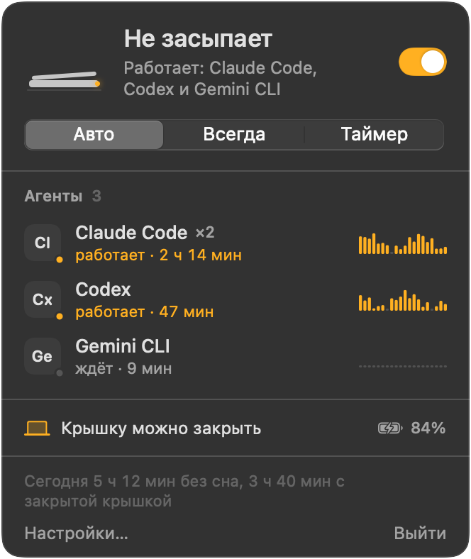

<p align="center">
  
</p>

<h1 align="center">Vibecode24</h1>

<p align="center">
  <b>Закройте крышку. Агенты продолжат работать.</b><br>
  Переключатель в строке меню macOS: MacBook не засыпает с закрытой крышкой, пока Claude Code, Codex и другие ИИ-агенты работают в терминале.
</p>

<p align="center">
  <a href="https://github.com/vladislavkovalskyi/vibecode24/releases/latest"></a>
  <a href="https://github.com/vladislavkovalskyi/vibecode24/releases"></a>
  <a href="LICENSE"></a>
  
  
</p>

<p align="center">
  <a href="README.md">English</a> · <b>Русский</b> · <a href="README.uk.md">Українська</a>
</p>

<p align="center">
  <picture>
    <source media="(prefers-color-scheme: dark)" srcset="docs/assets/popover-ru.png">
    <source media="(prefers-color-scheme: light)" srcset="docs/assets/popover-ru.png">
    
  </picture>
</p>

## Зачем

Вы запускаете Claude Code на большой рефакторинг, закрываете MacBook и идёте на встречу. macOS засыпает, терминал замирает, агент останавливается на полпути. `caffeinate` и привычные приложения против сна помогают, пока крышка открыта. Но если закрыть крышку без внешнего монитора, Mac всё равно уснёт.

Vibecode24 не даёт Mac уснуть с закрытой крышкой, пока работают агенты. Когда они закончат, сон вернётся.

## Возможности

- **Работа с закрытой крышкой.** Закрытый MacBook не спит от батареи и от сети, без внешнего монитора.
- **Режим «Авто»** (по умолчанию). Mac не спит, только пока работает хотя бы один отслеживаемый агент. Когда последний завершится, проходит 2 минуты, и сон возвращается.
- **«Всегда», «Таймер», «Выкл».** Таймер: 30 мин, 1 ч, 2 ч, 4 ч, 8 ч.
- **Радар агентов.** Узнаёт 17 агентских CLI из коробки, рисует живой график CPU для каждого агента и отмечает, работает он или ждёт. Можно добавить свои имена процессов.
- **Отпускание при простое.** По желанию. Возвращает сон, если все агенты простаивают N минут: удобно для агентов, которые ждут вашего ответа.
- **Защита.** Отпускает Mac, если заряд батареи ниже 15 % (порог настраивается) или macOS сообщает о критическом перегреве. По желанию отпускает и тогда, когда вы отключаете зарядку. Окно приложения показывает причину.
- **Сторож на случай сбоя.** Маленький процесс-сторож живёт дольше приложения. Если приложение упадёт, пока держит Mac без сна, сон вернётся в течение пяти секунд.
- **Экран гаснет вместе с крышкой.** Когда вы закрываете крышку, экран выключается. Если пароль требуется сразу, Mac заодно блокируется.
- **Уведомления.** Уведомление и звук, когда агент закончил, а когда вы открываете крышку, сводка: сколько она была закрыта и какие агенты за это время закончили.
- **Статистика сессий.** Сколько Mac не спал и сколько из этого времени с закрытой крышкой.
- **Горячая клавиша и URL-схема.** ⌃⌥⌘A переключает из любого места. Ссылки `vibecode24://` управляют приложением из скриптов.
- **Запуск при входе** и интерфейс на английском, русском и украинском. Язык меняется прямо в приложении.

<p align="center">
  
</p>

## Установка

Нужна macOS 14 Sonoma или новее. Одна универсальная сборка работает на Apple silicon и Intel.

### Скачать

1. Скачайте `Vibecode24-<version>.dmg` со страницы [Releases](https://github.com/vladislavkovalskyi/vibecode24/releases/latest).
2. Откройте DMG и перетащите **Vibecode24** в **Applications** («Программы»).
3. Запустите приложение и выполните шаги из раздела «Первый запуск».

### Homebrew

```sh
brew install --cask vladislavkovalskyi/tap/vibecode24
```

Cask сам снимает флаг карантина, поэтому после установки через Homebrew шаг с Gatekeeper ниже не нужен.

### Первый запуск

Vibecode24 подписан ad-hoc и не нотаризован ([почему](#почему-приложение-не-нотаризовано)). При первом запуске macOS его заблокирует и сообщит, что не может проверить приложение. Чтобы разрешить запуск:

1. Откройте Vibecode24 из папки «Программы». Когда появится предупреждение, нажмите **Готово**.
2. Откройте **Системные настройки → Конфиденциальность и безопасность** и прокрутите до блока **Безопасность**.
3. Рядом с сообщением о Vibecode24 нажмите **Все равно открыть** и подтвердите паролем.

Или снимите карантинный флаг в Терминале и откройте приложение как обычно:

```sh
xattr -dr com.apple.quarantine /Applications/Vibecode24.app
```

Когда вы впервые включите работу с закрытой крышкой, Vibecode24 один раз попросит пароль администратора, чтобы установить небольшое правило sudoers. Само правило показано в следующем разделе.

## Как это устроено

Vibecode24 использует два независимых слоя, потому что они закрывают разные ситуации:

| Ситуация | Слой | Нужен root |
|---|---|---|
| Крышка открыта, вы отошли | `IOPMAssertion` с `PreventUserIdleSystemSleep` (то же, что использует `caffeinate`) | Нет |
| Крышка закрыта, внешнего монитора нет | `pmset -a disablesleep 1` | Да |

Assertion macOS снимает сама, когда приложение завершается. С `disablesleep` иначе: это общесистемная настройка, и она остаётся включённой после выхода из приложения. Vibecode24 возвращает её в любом случае, подробности ниже.

### Правило sudoers

`pmset` требует root. Спрашивать пароль при каждом переключении нельзя, иначе приложением никто не будет пользоваться. Настоящий привилегированный помощник требует платного Apple Developer ID. Поэтому при первом использовании Vibecode24 один раз запрашивает пароль администратора, проверяет файл через `visudo -c` и кладёт его в `/etc/sudoers.d/vibecode24`:

```
yourname ALL=(root) NOPASSWD: /usr/bin/pmset -a disablesleep 1, /usr/bin/pmset -a disablesleep 0
```

`yourname` здесь означает короткое имя вашей учётной записи macOS. Дальше приложение выполняет эти две команды через `sudo -n`. Правило перечисляет команды целиком, вместе с аргументами, поэтому sudo откажет `pmset` с любыми другими аргументами и откажет любой другой программе. Ваш пользователь получает право выключать и включать сон, и больше ничего.

Убрать правило можно в **Настройки → Защита → Разрешение для закрытой крышки → Удалить…** или командой:

```sh
sudo rm /etc/sudoers.d/vibecode24
```

### Сон всегда возвращается

- **Выход из приложения, выход из системы, выключение, SIGTERM, SIGINT.** Перед завершением приложение выполняет `pmset -a disablesleep 0`.
- **Сбой или принудительное завершение.** Пока настройка включена, маленький процесс-сторож (`/bin/sh`, его запускает приложение) каждые пять секунд проверяет, живо ли приложение. Если приложения больше нет, сторож выполняет `sudo -n pmset -a disablesleep 0` и завершается. Вторая страховка: приложение записывает, что настройку включило оно, и при следующем запуске возвращает сон.
- **Настройку изменил кто-то другой.** Каждые 30 секунд приложение сверяет настоящее значение `SleepDisabled` с ожидаемым и исправляет расхождение.
- **Защита.** Низкий заряд или критический перегрев возвращают сон, пока приложение работает.
- **Ваша настройка остаётся вашей.** Если вы включили `disablesleep` сами, без приложения, Vibecode24 её не выключит.

Если что-то пошло не так, эта команда вернёт обычный сон:

```sh
sudo pmset -a disablesleep 0
```

Текущее значение покажет `pmset -g | grep SleepDisabled` (`1` значит, что сон отключён).

## Поддерживаемые агенты

| Агент | Команда |
|---|---|
| Claude Code | `claude` |
| Codex | `codex` |
| Gemini CLI | `gemini` |
| Aider | `aider` |
| OpenCode | `opencode` |
| Cursor Agent | `cursor-agent` |
| Copilot CLI | `copilot` |
| Amp | `amp` |
| Goose | `goose` |
| Qwen Code | `qwen` |
| Crush | `crush` |
| Droid | `droid` |
| Kiro | `kiro-cli` |
| Cline | `cline` |
| Continue CLI | `cn` |
| Auggie | `auggie` |
| Kilo Code | `kilo` |

Радар каждые три секунды читает таблицу процессов через `libproc` и не запускает `ps`. Он сверяет `argv[0]`, путь к исполняемому файлу, а для инструментов на Node и Python ещё и путь к скрипту. Вспомогательные процессы вроде `claude --chrome-native-host` или `codex app-server` он пропускает. Обёртка на Node и нативный бинарник, который она запускает, считаются одной сессией. CPU всего, что запускает агент (сборки, тесты), засчитывается этому агенту. Любого агента можно отключить в **Настройки → Агенты**.

Чтобы увидеть, что радар видит прямо сейчас:

```sh
/Applications/Vibecode24.app/Contents/MacOS/Vibecode24 --scan
```

Пользуетесь чем-то другим? Добавьте имя процесса в **Настройки → Агенты** или [попросите добавить агента](https://github.com/vladislavkovalskyi/vibecode24/issues/new?template=new_agent.yml).

## Автоматизация

Vibecode24 можно управлять из терминала, скрипта или хука оболочки:

```sh
open vibecode24://on        # не спать, пока не выключат («Всегда»)
open vibecode24://off       # разрешить сон
open vibecode24://auto      # не спать, пока работают агенты
open vibecode24://toggle    # то же, что ⌃⌥⌘A
open "vibecode24://timer?minutes=90"
```

Агентов из радара режим «Авто» уже отслеживает. Для всего остального, например долгого `xcodebuild` или своего пайплайна, оберните команду в функцию оболочки. Добавьте в `~/.zshrc`:

```zsh
# Keep the Mac awake for one command, then go back to Auto.
# The `always` block runs even if you press Ctrl-C.
awake() {
  open -g vibecode24://on
  { "$@" } always { open -g vibecode24://auto }
}
```

```sh
awake ./scripts/nightly-eval.sh
awake claude -p "migrate the test suite to Swift Testing"
```

`open -g` отправляет ссылку и не выводит никакое окно на передний план.

## Вопросы и ответы

### Не перегреется ли MacBook в сумке?

Может. Закрытый MacBook с работающим агентом всё равно греется, а сумка держит тепло. Оставьте Mac там, где есть приток воздуха: на столе, подставке или полке. Защита от перегрева вернёт сон, когда macOS сообщит о критической температуре, но считайте её последним рубежом.

### Что будет с батареей?

Mac не спит, поэтому разряжается так же, как с открытой крышкой и выключенным экраном. При заряде ниже 15 % Vibecode24 отпускает Mac, и он засыпает как обычно. Порог меняется в **Настройки → Защита**. Там же можно включить **Только при подключённой зарядке**.

### Нужен ли внешний монитор?

Нет. Штатному режиму закрытого дисплея (clamshell) нужны монитор, клавиатура и питание. Vibecode24 не даёт уснуть закрытому MacBook, даже если к нему ничего не подключено.

### Экран тоже останется включённым?

Нет, если вы сами об этом не попросите. Vibecode24 запрещает сон системы, а экран гаснет по своему обычному расписанию. Если хотите смотреть, как работает агент, включите **Не гасить экран, пока Mac не спит** в **Настройки → Основные**. Когда вы закрываете крышку, экран сразу выключается.

### Работает ли на Mac с Intel?

Да. В DMG лежит универсальный бинарник для Apple silicon и Intel. Нужна macOS 14 или новее.

### Почему приложение не нотаризовано?

Для нотаризации нужно платное членство в Apple Developer Program. Я делаю Vibecode24 бесплатно, в свободное время, поэтому релиз подписан ad-hoc. Весь исходный код здесь: его можно прочитать или [собрать приложение самому](#сборка-из-исходников).

### Как удалить приложение?

1. Откройте **Настройки → Защита** и нажмите **Удалить…** рядом с пунктом **Разрешение для закрытой крышки**.
2. Закройте Vibecode24 через его меню. При выходе сон возвращается.
3. Удалите `/Applications/Vibecode24.app` или выполните `brew uninstall --cask vibecode24`.
4. Проверьте, что файла `/etc/sudoers.d/vibecode24` больше нет. Если он остался, выполните `sudo rm /etc/sudoers.d/vibecode24`.

Если вы удалили приложение, пока оно не давало Mac уснуть, выполните `sudo pmset -a disablesleep 0`.

## Сборка из исходников

Нужны macOS 14 или новее и Xcode 16 (или тулчейн Swift 6).

```sh
git clone https://github.com/vladislavkovalskyi/vibecode24.git
cd vibecode24
swift test                 # run the tests
swift run Vibecode24 --scan  # print the agents the radar sees
scripts/build-app.sh       # build a universal, ad-hoc signed Vibecode24.app
scripts/make-dmg.sh        # wrap it in Vibecode24-<version>.dmg
```

## Участие в разработке

Баг-репорты, новые агенты и переводы приветствуются. Перед пулреквестом прочитайте [CONTRIBUTING.md](CONTRIBUTING.md) (на английском). В проекте действует [Кодекс поведения](CODE_OF_CONDUCT.md). О проблемах безопасности читайте в [SECURITY.md](SECURITY.md).

## Лицензия

[MIT](LICENSE) © 2026 Vladyslav Kovalskyi
