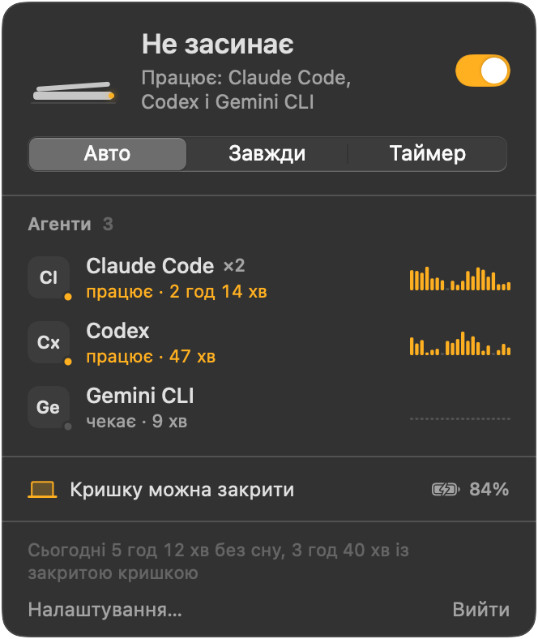

<p align="center">
  
</p>

<h1 align="center">Vibecode24</h1>

<p align="center">
  <b>Закрийте кришку. Агенти працюють далі.</b><br>
  Перемикач у рядку меню macOS: MacBook не засинає із закритою кришкою, поки Claude Code, Codex та інші ШІ-агенти працюють у терміналі.
</p>

<p align="center">
  <a href="https://github.com/vladislavkovalskyi/vibecode24/releases/latest"></a>
  <a href="https://github.com/vladislavkovalskyi/vibecode24/releases"></a>
  <a href="LICENSE"></a>
  
  
</p>

<p align="center">
  <a href="README.md">English</a> · <a href="README.ru.md">Русский</a> · <b>Українська</b>
</p>

<p align="center">
  <picture>
    <source media="(prefers-color-scheme: dark)" srcset="docs/assets/popover-uk.png">
    <source media="(prefers-color-scheme: light)" srcset="docs/assets/popover-uk.png">
    
  </picture>
</p>

## Навіщо

Ви запускаєте Claude Code на великий рефакторинг, закриваєте MacBook і йдете на зустріч. macOS засинає, термінал завмирає, агент зупиняється на півдорозі. `caffeinate` і звичні застосунки проти сну допомагають, поки кришка відкрита. Але якщо закрити кришку без зовнішнього монітора, Mac однаково засне.

Vibecode24 не дає Mac заснути із закритою кришкою, поки працюють агенти. Коли вони закінчать, сон повернеться.

## Можливості

- **Робота із закритою кришкою.** Закритий MacBook не спить від батареї та від мережі, без зовнішнього монітора.
- **Режим «Авто»** (типовий). Mac не спить, лише поки працює хоча б один агент, за яким стежить застосунок. Коли останній завершиться, минає 2 хвилини, і сон повертається.
- **«Завжди», «Таймер», «Вимк.».** Таймер: 30 хв, 1 год, 2 год, 4 год, 8 год.
- **Радар агентів.** Одразу розпізнає 17 агентських CLI, малює живий графік CPU для кожного агента й позначає, чи він працює, чи чекає. Можна додати власні назви процесів.
- **Відпускання під час простою.** За бажанням. Повертає сон, якщо всі агенти простоюють N хвилин: зручно для агентів, які чекають на вашу відповідь.
- **Захист.** Відпускає Mac, якщо заряд батареї нижчий за 15 % (поріг налаштовується) або macOS повідомляє про критичний перегрів. За бажанням відпускає й тоді, коли ви від’єднуєте зарядку. Вікно застосунку показує причину.
- **Сторож на випадок збою.** Маленький процес-сторож живе довше за застосунок. Якщо застосунок впаде, поки тримає Mac без сну, сон повернеться протягом п’яти секунд.
- **Екран гасне разом із кришкою.** Коли ви закриваєте кришку, екран вимикається. Якщо пароль потрібен одразу, Mac заразом блокується.
- **Сповіщення.** Сповіщення і звук, коли агент завершив, а коли ви відкриваєте кришку, підсумок: скільки вона була закрита і які агенти тим часом завершили.
- **Статистика сесій.** Скільки Mac не спав і скільки з цього часу із закритою кришкою.
- **Гаряча клавіша та URL-схема.** ⌃⌥⌘A перемикає звідусіль. Посилання `vibecode24://` керують застосунком зі скриптів.
- **Запуск під час входу** та інтерфейс англійською, російською й українською. Мову можна змінити безпосередньо в застосунку.

<p align="center">
  
</p>

## Встановлення

Потрібна macOS 14 Sonoma або новіша. Одна універсальна збірка працює на Apple silicon та Intel.

### Завантажити

1. Завантажте `Vibecode24-<version>.dmg` зі сторінки [Releases](https://github.com/vladislavkovalskyi/vibecode24/releases/latest).
2. Відкрийте DMG і перетягніть **Vibecode24** до **Applications** («Програми»).
3. Запустіть застосунок і виконайте кроки з розділу «Перший запуск».

### Homebrew

```sh
brew install --cask vladislavkovalskyi/tap/vibecode24
```

Кроки першого запуску потрібні й після встановлення через Homebrew.

### Перший запуск

Vibecode24 має підпис ad-hoc і не пройшов нотаризацію ([чому](#чому-застосунок-не-нотаризовано)). Під час першого запуску macOS заблокує його й повідомить, що не може перевірити застосунок. Щоб дозволити запуск:

1. Відкрийте Vibecode24 з папки «Програми». Коли з'явиться попередження, натисніть **Готово**.
2. Відкрийте **Системні параметри → Приватність і безпека** та прокрутіть до блоку **Безпека**.
3. Поруч із повідомленням про Vibecode24 натисніть **Усе одно відкрити** й підтвердьте паролем.

Або зніміть карантинну позначку в Терміналі та відкрийте застосунок як завжди:

```sh
xattr -dr com.apple.quarantine /Applications/Vibecode24.app
```

Коли ви вперше ввімкнете роботу із закритою кришкою, Vibecode24 один раз попросить пароль адміністратора, щоб встановити невелике правило sudoers. Саме правило наведено в наступному розділі.

## Як це працює

Vibecode24 використовує два незалежні шари, бо вони покривають різні ситуації:

| Ситуація | Шар | Потрібен root |
|---|---|---|
| Кришка відкрита, ви відійшли | `IOPMAssertion` з `PreventUserIdleSystemSleep` (те саме, що використовує `caffeinate`) | Ні |
| Кришка закрита, зовнішнього монітора немає | `pmset -a disablesleep 1` | Так |

Assertion macOS знімає сама, коли застосунок завершується. З `disablesleep` інакше: це загальносистемне налаштування, і воно лишається ввімкненим після виходу із застосунку. Vibecode24 повертає його за будь-яких обставин, подробиці нижче.

### Правило sudoers

`pmset` потребує root. Питати пароль під час кожного перемикання не можна, інакше застосунком ніхто не користуватиметься. Повноцінний привілейований помічник вимагає платного Apple Developer ID. Тому під час першого використання Vibecode24 один раз просить пароль адміністратора, перевіряє файл через `visudo -c` і кладе його в `/etc/sudoers.d/vibecode24`:

```
yourname ALL=(root) NOPASSWD: /usr/bin/pmset -a disablesleep 1, /usr/bin/pmset -a disablesleep 0
```

`yourname` тут означає коротке ім'я вашого облікового запису macOS. Далі застосунок виконує ці дві команди через `sudo -n`. Правило перелічує команди повністю, разом з аргументами, тож sudo відмовить `pmset` з будь-якими іншими аргументами й відмовить будь-якій іншій програмі. Ваш користувач отримує право вимикати й вмикати сон, і більше нічого.

Прибрати правило можна в **Налаштування → Захист → Дозвіл для закритої кришки → Видалити…** або командою:

```sh
sudo rm /etc/sudoers.d/vibecode24
```

### Сон завжди повертається

- **Вихід із застосунку, вихід із системи, вимкнення, SIGTERM, SIGINT.** Перед завершенням застосунок виконує `pmset -a disablesleep 0`.
- **Збій або примусове завершення.** Поки налаштування ввімкнене, маленький процес-сторож (`/bin/sh`, його запускає застосунок) кожні п’ять секунд перевіряє, чи застосунок живий. Якщо застосунку вже немає, сторож виконує `sudo -n pmset -a disablesleep 0` і завершується. Друга страховка: застосунок записує, що налаштування ввімкнув саме він, і під час наступного запуску повертає сон.
- **Налаштування змінив хтось інший.** Кожні 30 секунд застосунок звіряє справжнє значення `SleepDisabled` з очікуваним і виправляє розбіжність.
- **Захист.** Низький заряд або критичний перегрів повертають сон, поки застосунок працює.
- **Ваше налаштування лишається вашим.** Якщо ви ввімкнули `disablesleep` самі, без застосунку, Vibecode24 його не вимкне.

Якщо щось пішло не так, ця команда поверне звичайний сон:

```sh
sudo pmset -a disablesleep 0
```

Поточне значення покаже `pmset -g | grep SleepDisabled` (`1` означає, що сон вимкнено).

## Підтримувані агенти

| Агент | Команда |
|---|---|
| Claude Code | `claude` |
| Codex | `codex` |
| Gemini CLI | `gemini` |
| Aider | `aider` |
| OpenCode | `opencode` |
| Cursor Agent | `cursor-agent` |
| Copilot CLI | `copilot` |
| Amp | `amp` |
| Goose | `goose` |
| Qwen Code | `qwen` |
| Crush | `crush` |
| Droid | `droid` |
| Kiro | `kiro-cli` |
| Cline | `cline` |
| Continue CLI | `cn` |
| Auggie | `auggie` |
| Kilo Code | `kilo` |

Радар кожні три секунди читає таблицю процесів через `libproc` і не запускає `ps`. Він звіряє `argv[0]`, шлях до виконуваного файлу, а для інструментів на Node і Python ще й шлях до скрипту. Допоміжні процеси на кшталт `claude --chrome-native-host` чи `codex app-server` він пропускає. Обгортка на Node і нативний бінарний файл, який вона запускає, рахуються як одна сесія. CPU всього, що запускає агент (збирання, тести), зараховується цьому агентові. Будь-якого агента можна вимкнути в **Налаштування → Агенти**.

Щоб побачити, що радар бачить просто зараз:

```sh
/Applications/Vibecode24.app/Contents/MacOS/Vibecode24 --scan
```

Користуєтеся чимось іншим? Додайте назву процесу в **Налаштування → Агенти** або [попросіть додати агента](https://github.com/vladislavkovalskyi/vibecode24/issues/new?template=new_agent.yml).

## Автоматизація

Керувати Vibecode24 можна з термінала, скрипту або хука оболонки:

```sh
open vibecode24://on        # не спати, доки не вимкнуть («Завжди»)
open vibecode24://off       # дозволити сон
open vibecode24://auto      # не спати, поки працюють агенти
open vibecode24://toggle    # те саме, що ⌃⌥⌘A
open "vibecode24://timer?minutes=90"
```

Агентів із радара режим «Авто» вже відстежує. Для всього іншого, наприклад довгого `xcodebuild` чи власного пайплайна, загорніть команду у функцію оболонки. Додайте до `~/.zshrc`:

```zsh
# Keep the Mac awake for one command, then go back to Auto.
# The `always` block runs even if you press Ctrl-C.
awake() {
  open -g vibecode24://on
  { "$@" } always { open -g vibecode24://auto }
}
```

```sh
awake ./scripts/nightly-eval.sh
awake claude -p "migrate the test suite to Swift Testing"
```

`open -g` надсилає посилання й не виводить жодного вікна на передній план.

## Запитання та відповіді

### Чи не перегріється MacBook у сумці?

Може. Закритий MacBook з агентом, що працює, однаково гріється, а сумка тримає тепло. Залиште Mac там, де є приплив повітря: на столі, підставці чи полиці. Захист від перегріву поверне сон, коли macOS повідомить про критичну температуру, але вважайте його останнім рубежем.

### Що буде з батареєю?

Mac не спить, тому розряджається так само, як із відкритою кришкою та вимкненим екраном. Коли заряд падає нижче 15 %, Vibecode24 відпускає Mac, і той засинає як завжди. Поріг змінюється в **Налаштування → Захист**. Там само можна ввімкнути **Лише з під’єднаною зарядкою**.

### Чи потрібен зовнішній монітор?

Ні. Штатному режиму закритого дисплея (clamshell) потрібні монітор, клавіатура й живлення. Vibecode24 не дає заснути закритому MacBook, навіть якщо до нього нічого не під'єднано.

### Екран теж лишатиметься ввімкненим?

Ні, якщо ви самі про це не попросите. Vibecode24 забороняє сон системи, а екран гасне за своїм звичайним розкладом. Якщо хочете дивитися, як працює агент, увімкніть **Не вимикати екран, доки Mac не спить** у **Налаштування → Загальні**. Коли ви закриваєте кришку, екран одразу вимикається.

### Чи працює на Mac з Intel?

Так. У DMG лежить універсальний бінарний файл для Apple silicon та Intel. Потрібна macOS 14 або новіша.

### Чому застосунок не нотаризовано?

Для нотаризації потрібне платне членство в Apple Developer Program. Я роблю Vibecode24 безкоштовно, у вільний час, тому реліз має підпис ad-hoc. Увесь вихідний код тут: його можна прочитати або [зібрати застосунок самостійно](#збирання-з-вихідного-коду).

### Як видалити застосунок?

1. Відкрийте **Налаштування → Захист** і натисніть **Видалити…** біля пункту **Дозвіл для закритої кришки**.
2. Закрийте Vibecode24 через його меню. Після виходу сон повертається.
3. Видаліть `/Applications/Vibecode24.app` або виконайте `brew uninstall --cask vibecode24`.
4. Перевірте, що файлу `/etc/sudoers.d/vibecode24` більше немає. Якщо він лишився, виконайте `sudo rm /etc/sudoers.d/vibecode24`.

Якщо ви видалили застосунок, поки він не давав Mac заснути, виконайте `sudo pmset -a disablesleep 0`.

## Збирання з вихідного коду

Потрібні macOS 14 або новіша та Xcode 16 (або тулчейн Swift 6).

```sh
git clone https://github.com/vladislavkovalskyi/vibecode24.git
cd vibecode24
swift test                 # run the tests
swift run Vibecode24 --scan  # print the agents the radar sees
scripts/build-app.sh       # build a universal, ad-hoc signed Vibecode24.app
scripts/make-dmg.sh        # wrap it in Vibecode24-<version>.dmg
```

## Участь у розробці

Звіти про помилки, нові агенти й переклади вітаються. Перед пул-реквестом прочитайте [CONTRIBUTING.md](CONTRIBUTING.md) (англійською). У проєкті діє [Кодекс поведінки](CODE_OF_CONDUCT.md). Про проблеми безпеки читайте в [SECURITY.md](SECURITY.md).

## Ліцензія

[MIT](LICENSE) © 2026 Vladyslav Kovalskyi
